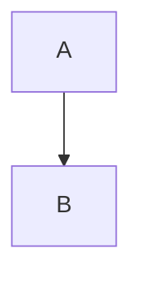

Titel
=====

Untertitel
----------

## Tabelle

| a | b |
|---|---|
| 1 | 2 |

```js
const x = "<!-- @ai: kein Kommentar, das ist Code -->";
```



    eingerückter Code

<div align="center">
  <b>HTML-Block</b>
</div>

***

Absatz
direkt gefolgt von
# einer Überschrift
